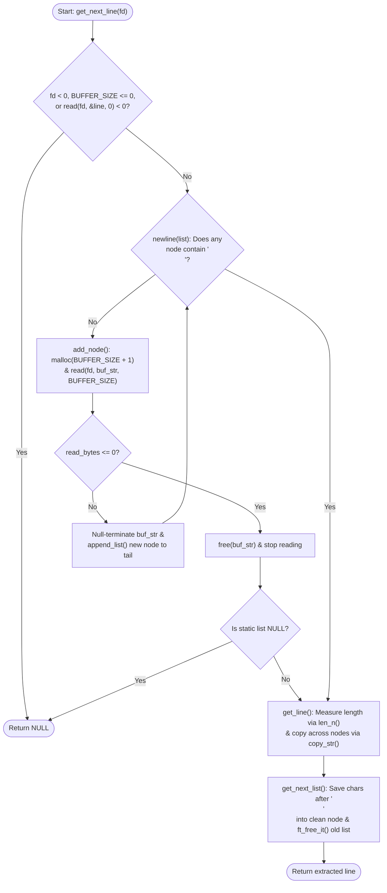

*This project has been created as part of the 42 curriculum by ooulahra.*

# 📖 get_next_line

> *Reading a line from a file descriptor is way too tedious.* — **42 School Project**

## 📌 Description

**`get_next_line`** is a C programming project from the 42 curriculum that challenges you to write a function capable of reading a text file (or any valid file descriptor) **one line at a time**.

Instead of repeatedly reallocating and concatenating strings on every `read()` call, this implementation uses a **singly linked list (`t_list`)** as a dynamic buffer stash to store read chunks until a newline (`\n`) or `EOF` is encountered.

Through this project, you explore essential low-level C concepts:
- **Static variables** and persistent linked-list state across function calls
- **Linked list manipulation** (`t_list`) for efficient chunked buffering
- **Dynamic memory allocation** (`malloc` / `free`) with zero memory leaks
- **File descriptors** and buffered I/O using the `read()` system call

---

## 🛠️ Function Prototype

```c
char *get_next_line(int fd);
```

| Parameter | Description |
| :--- | :--- |
| `fd` | The file descriptor to read from (e.g., a file, `0` for `stdin`, or a pipe). |

**Return Value:**
- **Read line:** Correct behavior (includes the terminating `\n` character, unless End-Of-File is reached without one).
- **`NULL`:** Nothing else to read, invalid `fd` / `BUFFER_SIZE`, or a `read()` error occurred.

---

## 🧠 Algorithm & Data Structure

### Why a Linked List (`t_list`)?

Each node in the static linked list holds a dynamically allocated buffer (`str`) of up to `BUFFER_SIZE` bytes read from `fd`:

```c
typedef struct s_list
{
    char            *str;
    struct s_list   *next;
}   t_list;
```

Appending each `read()` chunk as a new node avoids repeated `strjoin` reallocations while searching for `\n`. Once a newline is found, the exact output length is calculated across the nodes, assembled in a single allocation, and all consumed nodes are freed—leaving only a single clean node with any leftover characters after `\n`.

### 1. Execution Flowchart



### 2. Linked List Stash Lifecycle

Because `read()` fetches fixed chunks of `BUFFER_SIZE` bytes rather than stopping at `\n`, chunks are chained as nodes and trimmed after each line is returned:

```mermaid
flowchart LR
    subgraph Call1 ["Call 1: BUFFER_SIZE = 5"]
        direction TB
        R1["read #1: 'Hello' (no '&#92;n')<br/>read #2: '&#92;nWorl' (has '&#92;n')"] --> L1["List: ['Hello'] -> ['&#92;nWorl']"]
        L1 --> Out1(["get_line() returns: 'Hello&#92;n'"])
        L1 --> Rem1["get_next_list() frees old nodes<br/>Static list keeps: ['Worl']"]
    end

    subgraph Call2 ["Call 2: BUFFER_SIZE = 5"]
        direction TB
        Rem1 --> R2["read #1: 'd!&#92;nHi' (has '&#92;n')"]
        R2 --> L2["List: ['Worl'] -> ['d!&#92;nHi']"]
        L2 --> Out2(["get_line() returns: 'World!&#92;n'"])
        L2 --> Rem2["get_next_list() frees old nodes<br/>Static list keeps: ['Hi']"]
    end
```



---

## 📂 Project Structure & Functions

```text
get_next_line/
├── get_next_line.h             # Struct t_list, prototypes, includes, default BUFFER_SIZE
├── get_next_line.c             # Core logic: get_next_line, add_node, append_list, get_line, get_next_list
├── get_next_line_utils.c       # Helpers: findlastnode, len_n, newline, copy_str, ft_free_it
├── get_next_line_bonus.h       # Bonus header supporting multiple file descriptors
├── get_next_line_bonus.c       # Bonus core logic using static t_list *list[2000]
└── get_next_line_utils_bonus.c # Bonus linked-list helper functions
```

| Function | File | Role |
| :--- | :--- | :--- |
| `get_next_line` | `get_next_line.c` | Validates `fd` / `BUFFER_SIZE`, orchestrates reading, line building, and list cleanup. |
| `add_node` | `get_next_line.c` | Reads `BUFFER_SIZE` chunks from `fd` into the list until a `\n` or `EOF` is reached. |
| `append_list` | `get_next_line.c` | Allocates a new `t_list` node and links it to the tail of the list. |
| `get_line` | `get_next_line.c` | Allocates the exact line size and copies characters across nodes up to `\n` or `EOF`. |
| `get_next_list` | `get_next_line.c` | Extracts leftover characters after `\n` from the last node into a fresh `clean` node. |
| `findlastnode` | `get_next_line_utils.c` | Traverses and returns a pointer to the final node in the linked list. |
| `len_n` | `get_next_line_utils.c` | Computes total character count from the head node up to and including `\n` (or `EOF`). |
| `newline` | `get_next_line_utils.c` | Scans all nodes in the list and returns `1` if a `\n` character is present. |
| `copy_str` | `get_next_line_utils.c` | Copies characters sequentially across nodes into the destination line buffer. |
| `ft_free_it` | `get_next_line_utils.c` | Frees all old nodes and strings, keeping the `clean` node only if leftover data exists. |

---

## 🌟 Bonus Part: Multiple File Descriptors

In the mandatory part, a single `static t_list *list` tracks one file descriptor at a time. Alternating between different descriptors would mix their list nodes.

In the **bonus implementation**, the static variable is upgraded to an array of linked-list heads indexed by `fd`:

```c
static t_list *list[2000];
```

With bounds validation (`fd < 0 || fd > 2000`), each open file descriptor maintains its own independent linked list of unread chunks, allowing interleaved reads across multiple files simultaneously:

```c
line1 = get_next_line(fd1); // Reads line 1 from file A (list[fd1])
line2 = get_next_line(fd2); // Reads line 1 from file B (list[fd2])
line3 = get_next_line(fd1); // Reads line 2 from file A (list[fd1])
```

---

## 🚀 Instructions

### 1. Create a `main.c` test file

```c
#include <fcntl.h>
#include <stdio.h>
#include <stdlib.h>
#include "get_next_line.h"

int main(void)
{
    int     fd;
    char    *line;

    fd = open("test.txt", O_RDONLY);
    if (fd < 0)
        return (1);
    while ((line = get_next_line(fd)) != NULL)
    {
        printf("%s", line);
        free(line);
    }
    close(fd);
    return (0);
}
```

### 2. Compile with a custom `BUFFER_SIZE`

Define `BUFFER_SIZE` at compile time using the `-D` flag:

```bash
# Mandatory version
cc -Wall -Wextra -Werror -D BUFFER_SIZE=42 get_next_line.c get_next_line_utils.c main.c -o gnl

# Bonus version
cc -Wall -Wextra -Werror -D BUFFER_SIZE=42 get_next_line_bonus.c get_next_line_utils_bonus.c main.c -o gnl_bonus

# Run
./gnl
```

---

## 🧪 Edge Cases Tested

- `BUFFER_SIZE = 1` (single-byte node chain reading)
- `BUFFER_SIZE = 42` (standard buffer size)
- `BUFFER_SIZE = 10000000` (huge buffer size)
- `BUFFER_SIZE = 0` or negative values (safely returns `NULL`)
- Empty files (returns `NULL` without leaks)
- Files containing only `\n` characters (frees empty `clean` node via `ft_free_it`)
- Very long lines (> 10,000 characters spanning dozens of `t_list` nodes)
- Files with no trailing newline at `EOF`
- Invalid or closed file descriptors (`fd = -1`, `fd > 2000`, `read(fd, &line, 0) < 0`)
- Reading from Standard Input (`fd = 0`)

---

## 📚 Resources

- **`man 2 read`** — System call manual for reading from a file descriptor.
- **`man 3 malloc` / `man 3 free`** — Manual pages for heap memory allocation and deallocation.
- **42 Cursus Subject (`get_next_line.pdf`)** — Official project specification, Norminette rules, and edge-case constraints.
- **AI Usage:** AI was used as a learning resource to understand the underlying concepts and improve problem-solving skills rather than blindly copying solutions.